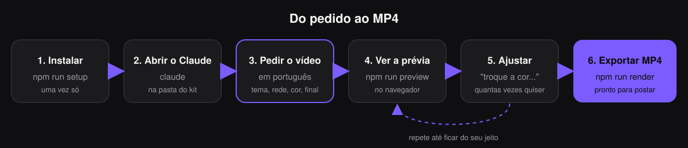
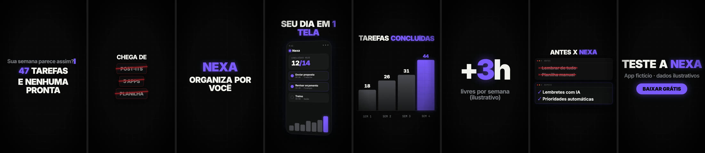
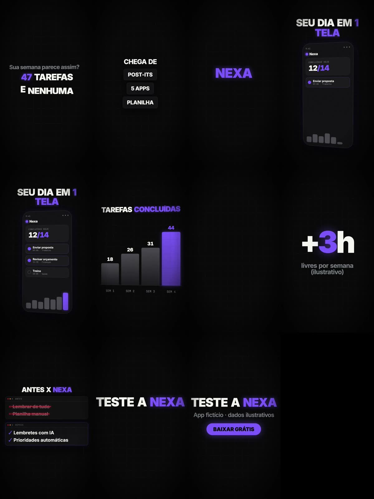
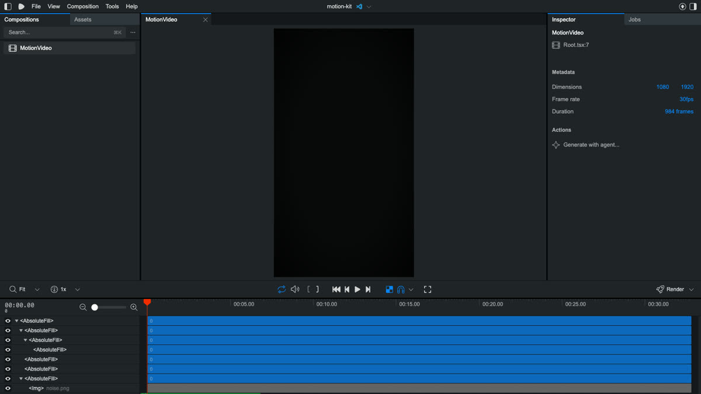

# Seu primeiro vídeo, passo a passo

Tempo: **cerca de 20 minutos** na primeira vez (incluindo 3 minutos de render).
Você não precisa saber programar. Cada passo mostra **o que digitar** e **o que deve aparecer**.



> Ainda não instalou? Faça primeiro a [INSTALACAO.md](INSTALACAO.md). Ela termina com a mensagem **"Instalação concluída"**.

---

## Antes de começar: abrir o terminal na pasta do kit

**macOS:** abra o app **Terminal**, digite `cd ` (com um espaço no final), **arraste a pasta do kit** para a janela e aperte Enter.

**Windows:** abra a pasta do kit no Explorador de Arquivos, clique na barra de endereço, digite `cmd` e aperte Enter.

Para confirmar que está no lugar certo:

```
npm run doctor
```

O que deve aparecer (o final):

```
Diagnóstico do MotionLab Kit
  ✔ Node.js: v20...
  ✔ FFmpeg: ...
  ✔ Python: 3...
  ✔ Remotion (animação): v4.0.532
  ! Chave Gemini (opcional): não configurada ...

Tudo pronto para criar vídeos.
```

Itens com **!** são opcionais. Se aparecer **✘**, leia a linha "como resolver" logo abaixo dele.

---

## Passo 1 — Veja o que o kit faz (3 minutos)

```
npm run demo
```

O kit cria um vídeo de exemplo de um aplicativo **fictício** chamado Nexa. Enquanto renderiza, aparecem linhas como
`Rendered 412/984`. No final:

```
  ✔ MP4 pronto em 2.4 min: videos/nexa-app-demo/saida/nexa-app-demo.mp4
```

Abra esse arquivo (dois cliques). As 8 cenas do exemplo:



1 título digitado · 2 etiquetas riscadas · 3 revelação com impacto · 4 tela de app · 5 gráfico de barras ·
6 número que conta · 7 antes x depois · 8 chamada final com botão. Tudo com trilha e efeitos sonoros.

---

## Passo 2 — Abra o Claude Code

No mesmo terminal:

```
claude
```

Na primeira vez ele pede para entrar na sua conta (abre o navegador). Depois aparece uma caixa para você escrever.

---

## Passo 3 — Peça o seu vídeo

Copie, troque o que está entre [colchetes] e cole na caixa do Claude:

```
Crie um vídeo de 20 segundos para Instagram (vertical) apresentando [nome do seu negócio],
que [o que você faz, em uma frase]. Público: [para quem]. Cor de destaque: [cor].
Chamada final: "[o que a pessoa deve fazer]". Gere só a prévia, ainda não exporte.
```

Exemplo real usado nos nossos testes:

```
Crie um vídeo de 12 segundos para Instagram apresentando a cafeteria fictícia 'Grão Norte'
(café especial, abre às 7h). Cor de destaque laranja. Gere só a prévia, não exporte o MP4.
```

O Claude vai pedir permissão para rodar comandos como `npm run novo` e `npm run previa`. **Leia e aprove.**
Ele cria o vídeo, olha as imagens da prévia, corrige o que ficou ruim e responde algo como:

```
A prévia está em videos/grao-norte/saida/previa.mp4 e as imagens de cada cena em
videos/grao-norte/saida/previa.jpg. Para mudar os textos, edite videos/grao-norte/conteudo.json.
```

A "folha de prévia" (`previa.jpg`) mostra vários momentos do vídeo de uma vez, assim:



---

## Passo 4 — Veja em movimento

Abra **outro** terminal na pasta do kit (o primeiro está com o Claude) e rode, com o nome que o Claude deu ao vídeo:

```
npm run preview -- grao-norte
```

O navegador abre o **Remotion Studio**:



- **Espaço** toca e pausa. O primeiro quadro costuma ser escuro: aperte espaço.
- A linha do tempo embaixo mostra os segundos; clique nela para pular.
- **Não use o botão "Render" do Studio.** Exporte pelo passo 6, que já mistura a trilha certinho.
- Deixe o Studio aberto enquanto ajusta: ele atualiza sozinho.
- Para fechar: volte ao terminal do preview e aperte **Ctrl + C**.

---

## Passo 5 — Ajuste conversando

Volte ao Claude e peça mudanças, uma ou várias por vez:

```
Troque a cor de destaque para verde-limão.
Na cena 2, escreva "Grãos da Bahia" no lugar de "Grãos frescos".
Deixe a chamada final com impacto.
```

O Studio mostra as mudanças em segundos.

**Prefere editar você mesmo?** Abra `videos/<nome>/conteudo.json` em um editor de texto, troque os textos entre aspas,
salve e rode `npm run checar -- <nome>`. Se houver erro de digitação, ele mostra a linha e como consertar:

```
Erro: O arquivo videos/grao-norte/conteudo.json tem um erro de digitação.
  linha 42, coluna 17:  "titulo": “Esqueça”,
Dica: há aspas curvas “ ” (coladas do Word/WhatsApp): troque por aspas retas ".
```

---

## Passo 6 — Exporte o MP4

Peça ao Claude **"exporte o vídeo final"** ou rode:

```
npm run render -- grao-norte
```

Leva de 1 a 5 minutos. No final:

```
  ✔ MP4 pronto em 1.1 min: videos/grao-norte/saida/grao-norte.mp4
```

Esse arquivo vai direto para o Instagram, TikTok ou YouTube. Arquivo menor para WhatsApp: `npm run render -- grao-norte --qualidade leve`.

---

## Se algo der errado

| O que aparece | O que fazer |
|---|---|
| `Missing script: "demo"` | você não está na pasta do kit (volte ao "Antes de começar") |
| `claude: command not found` | instale o Claude Code (INSTALACAO.md, passo 1) |
| `FFmpeg não encontrado: o vídeo vai sair SEM trilha` | instale o FFmpeg (INSTALACAO.md, passo 1) e exporte de novo |
| `Vídeo "x" não encontrado` | use o nome que aparece na lista da mensagem |
| `O render falhou` | siga o "Como recuperar" que aparece logo abaixo |
| qualquer outra coisa | `npm run doctor` e depois [ERROS-COMUNS.md](ERROS-COMUNS.md) |

## Próximos passos

- Pedidos prontos: [GUIA-DE-PROMPTS.md](GUIA-DE-PROMPTS.md)
- Cores, textos, imagens e tipos de cena: [PERSONALIZACAO.md](PERSONALIZACAO.md)
- Narração com voz: escreva o texto em `videos/<nome>/roteiro.txt` e peça "gere a narração e sincronize as cenas"
- Formatos para cada rede: [EXPORTACAO.md](EXPORTACAO.md)
